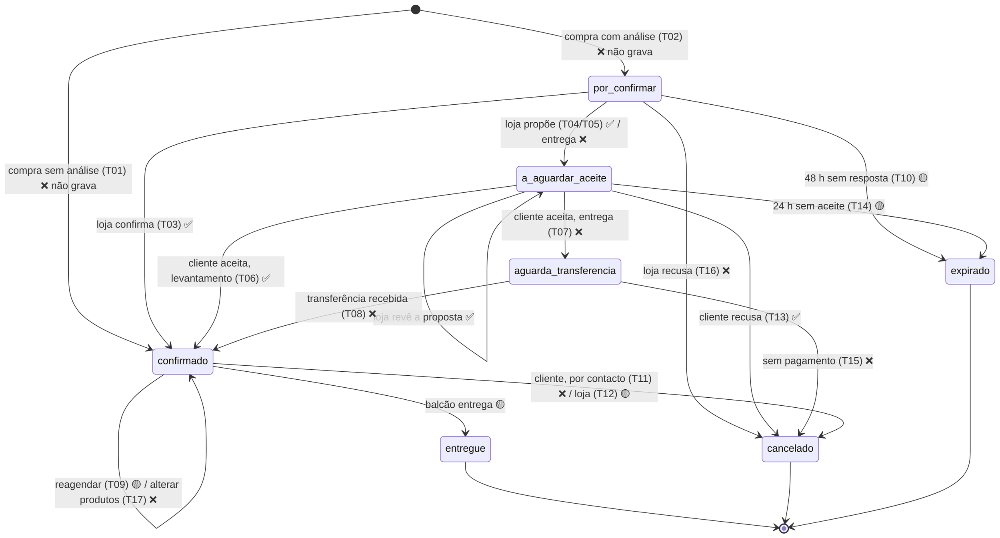
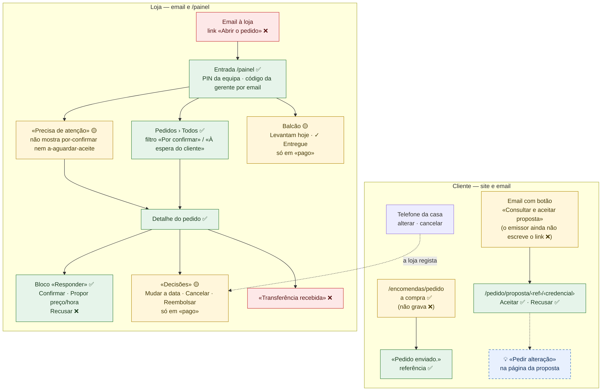
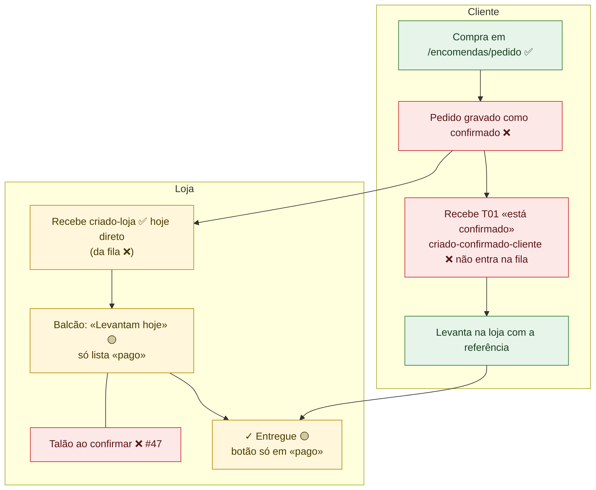
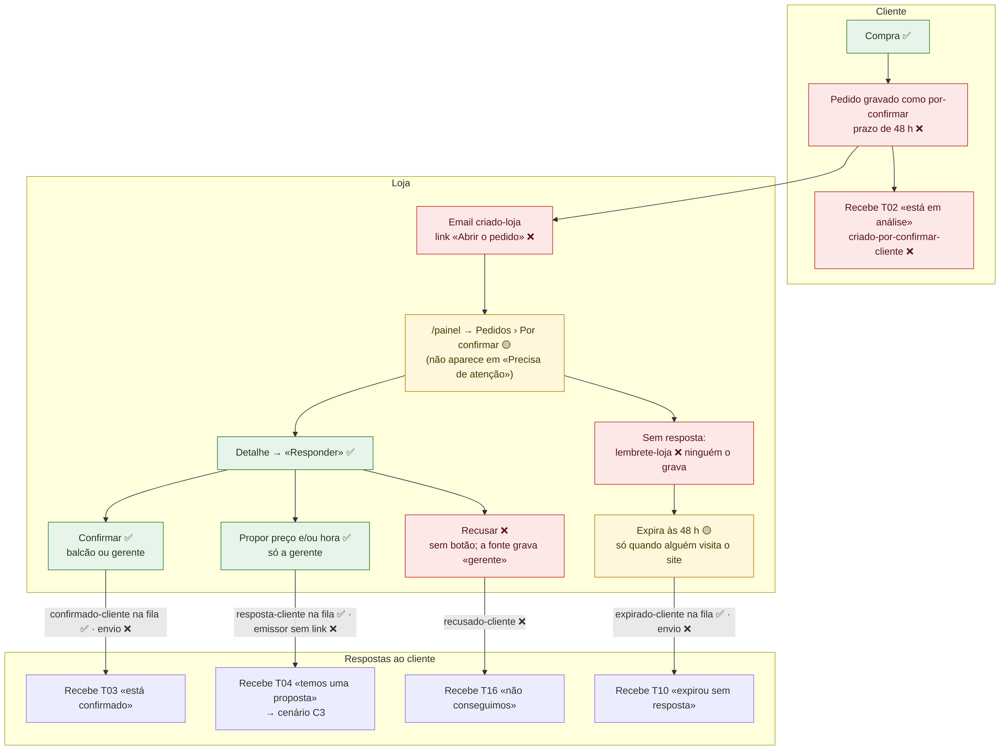
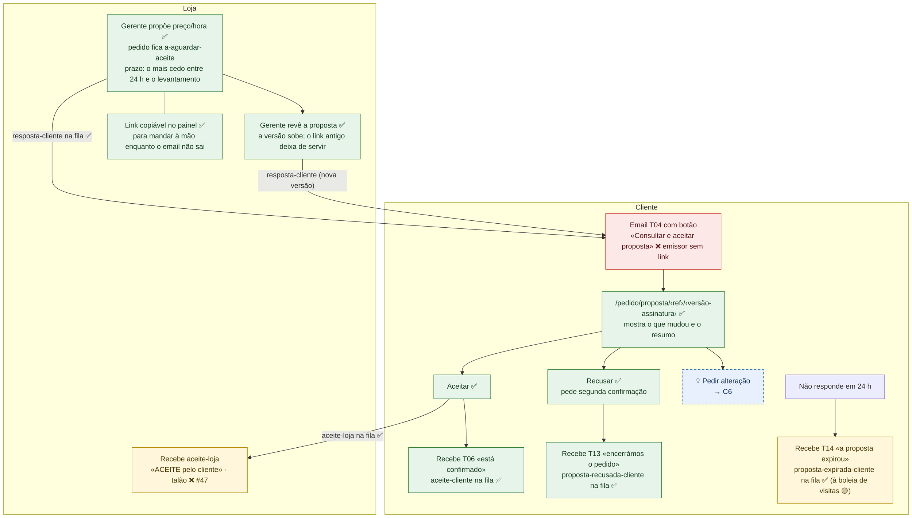
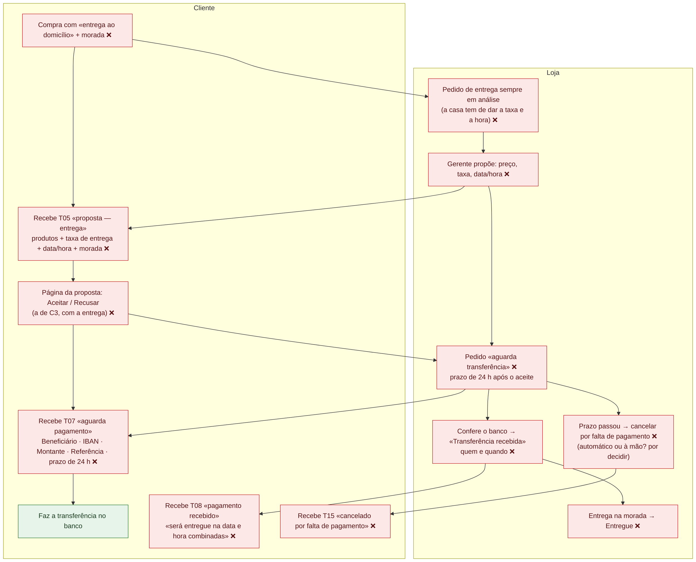
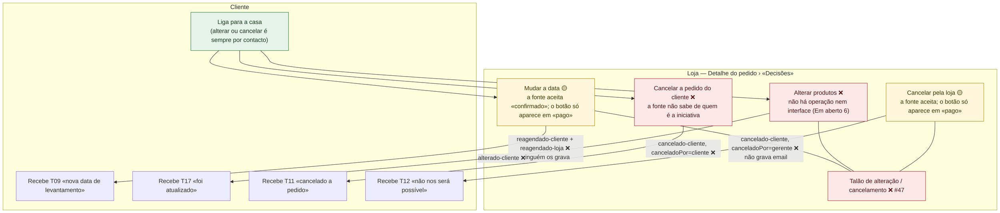
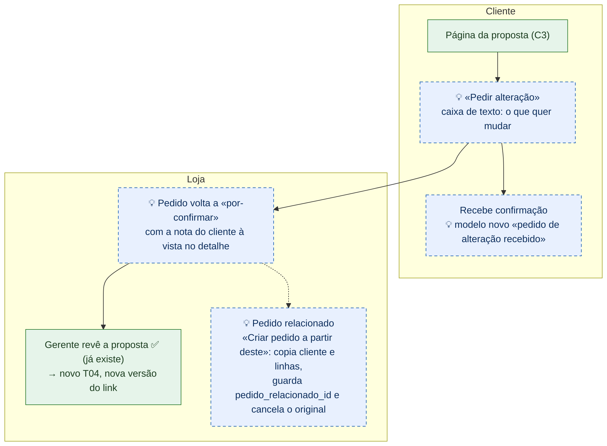

# O fluxo do pedido, de ponta a ponta — e o que falta

O percurso completo de um pedido, do lado do cliente e do lado da loja, com os
emails de cada passo. Parte do diagrama da Andreia («Diagrama e template
Damira», 24/11, textos T01–T17) e põe ao lado de cada passo **onde se faz** e
**se o código já o faz**.

É para o Sobral e o Gonçalo verem o fluxo inteiro, saberem o que falta e
testarem os cenários juntos (secção 7). Escrito a 26/11, contra o `main` em
`ce0de4b`.

**A simulação, passo a passo, está em `docs/loja/simulacao/`.** São duas
páginas para abrir no browser, com as capturas do site e do painel e os emails
tal como o código os escreve:
- `equipa.html` diz, em cada passo, o que falta e quem o faz;
- `andreia.html` mostra só o percurso, para validar com a casa.

Geram-se com `python3 docs/loja/simulacao/gerar.py equipa` (e `andreia`), a
partir da raiz.

⚠️ **Não substitui o `pedidos.md`.** O contrato continua a ser ele: os estados,
o dinheiro e as regras. Este ficheiro mostra o fluxo e as falhas. Onde propõe
alguma coisa que o `pedidos.md` ainda tem em aberto (n.º 6, 8 e 9), diz isso e
remete para lá.

## 1. Como ler

| Marca | Quer dizer |
|---|---|
| ✅ | existe no `main` e funciona |
| 🟡 | existe em parte (a fonte faz, a interface não; ou grava, mas não envia) |
| ❌ | falta |
| 💡 | proposta: não está no diagrama da Andreia e está por decidir |

Nos diagramas, as cores dizem o mesmo: verde ✅, amarelo 🟡, vermelho ❌ e azul
a tracejado 💡.

**Três coisas valem para todos os cenários**, e por isso não se repetem em cada um:

1. **A compra ainda não grava o pedido.** `enviarCompra`
   (`src/app/[locale]/encomendas/pedido/acoes.ts:56`) só manda um email à casa,
   o `criado-loja`, direto e fora da fila (`:167`). O `criarPedido`
   (`src/lib/dados/bd-pedidos.ts:288`) existe, mas ninguém o chama, e também
   não põe nenhum email na fila. **Sem isto, nada deste fluxo acontece no site.**
2. **Os emails da fila saem desde o ponto 2 (26/11)**: o `enviarDepois()`
   (`src/lib/emails/depois.ts`) é chamado depois da compra, do aceite e da recusa
   da proposta e das decisões do painel, incluindo o «Confirmar» do balcão. As novas tentativas sem visitas (#149)
   ainda não entraram, e em modo de teste tudo vai para a caixa de `EMAILS_SO_PARA`.
3. **A referência.** O diagrama usa `#00001`; o código usa `DAM-2611-HYUS`. Fica
   para a Andreia dizer se aceita a do código.

## 2. Os estados

Os estados do código estão em `ESTADOS_PEDIDO` (`src/lib/dados/tipos.ts:286`):
`por-confirmar`, `a-aguardar-aceite`, `confirmado`, `pendente`, `pago`,
`entregue`, `expirado`, `cancelado`. O `pendente` e o `pago` são do Stripe, que
dorme, e ficam fora deste diagrama.

**`aguarda_transferencia` não existe** ❌. É preciso para a entrega ao domicílio
(secção 6, ponto 8). Pode ser um estado novo, ou o `pendente` reaproveitado com
o modo `transferencia`. É uma decisão de esquema, e é do Sobral.

## 3. Onde se trabalha (C0)

Cada ação dos cenários acontece num destes sítios. As setas dizem que
transições se fazem a partir de cada sítio.

**Como a loja chega a um pedido hoje:** entra no `/painel`, vai a «Pedidos»,
escolhe o filtro «Por confirmar» ou «À espera do cliente» e abre o detalhe. O
email da loja diz «Responde-se no painel, em "Por confirmar"»
(`src/lib/emails/textos.ts:230,423`), mas **não traz link nenhum**, e o painel
**não tem endereço por pedido** (`src/app/painel/page.tsx:33` só lê `?entrar`).

## 4. Os cenários

### C1. Levantamento sem análise

Todos os artigos têm preço e nenhum pede confirmação.

### C2. Levantamento com análise

Há um artigo sem preço (o bolo por medida) ou com «Necessita de confirmação».

**Onde está no código:**
- Responder: `responderPedido`, em `src/lib/dados/bd-painel-pedidos.ts:375`. Confirma em `:412` e propõe em `:436`.
- A interface é `src/components/painel/gestao/Responder.tsx`, que só aparece dentro de `DetalhePedido.tsx:116`.
- Só a gerente propõe; é a fonte que o verifica (`planearResposta`, em `regras.ts`).
- Expirar: `expirar`, em `bd-pedidos.ts:92`, que corre à boleia de `ocupacao` e de `criarPedido`.

### C3. Proposta de levantamento (T04)

**Onde está no código:**
- A página: `src/app/[locale]/pedido/proposta/[referencia]/[credencial]/page.tsx`, com `src/components/pedido/DecisaoProposta.tsx`.
- Aceitar e recusar: `aceitarProposta` e `recusarProposta`, em `bd-pedidos.ts:373` e `:386`. Os dois gravam os emails na mesma instrução.
- A credencial é `src/lib/proposta.ts` (`caminhoDaProposta`), assinada com o `PROPOSTA_SEGREDO`.
- ⚠️ O emissor exclui o `resposta-cliente` (`src/lib/emails/emissor.ts:20`) e não passa o `linkAceitar`. Enquanto isso não mudar, o T04 **nunca sai**, e a gerente tem de copiar o link no painel.

### C4. Entrega ao domicílio (T05, T07, T08, T15) — tudo ❌

Está no diagrama da Andreia e foi pedida para 29/11. No código não existe
nenhuma parte: nem o modo `transferencia` (`MODOS_PAGAMENTO`, em
`src/lib/dados/tipos.ts:311`), nem a morada, nem a taxa de entrega, nem o IBAN
na configuração, nem os modelos T05, T07 e T08. O `pedidos.md` tem as regras
(`:266-320`), mas o n.º 8 do «Em aberto» (zonas, custo, quem entrega,
capacidade) ainda espera pela Andreia.

### C5. Depois de confirmado

**Onde está no código:**
- `reagendarPedido` em `bd-painel-pedidos.ts:314`, com `REAGENDAVEIS = ["pago", "confirmado"]` em `regras.ts`.
- `cancelarPedido` em `:352`, com `CANCELAVEIS_NA_LOJA = ["por-confirmar", "a-aguardar-aceite", "confirmado"]` em `regras.ts`. Grava sempre `cancelado_por = 'gerente'` (`:362`) e não grava nenhum email.
- Os botões estão em `src/components/painel/gestao/Decisoes.tsx:249` (Mudar a data) e `:264` (Cancelar), os dois presos a `pedido.estado === "pago"`.

### C6. 💡 Propostas: o cliente pede alterações, e o pedido relacionado

**Não estão no diagrama da Andreia** e o `pedidos.md` tem-nas em aberto: o n.º
6 (alterar as linhas de um confirmado) e o n.º 9 (propor uma alteração a um
confirmado). Ficam aqui desenhadas para se decidir com o fluxo à frente.

**Perguntas antes de decidir:**
1. **Para o Gonçalo e a Andreia.** O «Pedir alteração» substitui o «ligue-nos» ou soma-se a ele? Se se soma, o rodapé dos emails continua a mandar ligar.
2. **Para a Andreia.** Com o pedido já confirmado, uma alteração de produtos edita o pedido (T17, uma linha a mais no talão) ou cancela-o e cria um relacionado? A proposta atual do `pedidos.md` (n.º 6) é não editar.
3. **Para o Sobral (esquema).** O `pedido_relacionado_id` e a nota de alteração do cliente são colunas novas: vão num PR só de esquema.

## 5. Os emails: T01–T17 contra o código

«Na fila» é quem grava a linha em `emails_por_enviar`. «O emissor escreve»
quer dizer que o `dadosDoEmail` (`src/lib/emails/emissor.ts:22`) tem os dados
que o modelo exige. Os textos estão em `src/lib/emails/textos.ts`, e a lista em
`MODELOS_EMAIL` (`src/lib/emails/tipos.ts:2`).

| T | Modelo | Para | O que o dispara | Na fila | O emissor escreve | Estado |
|---|---|---|---|---|---|---|
| T01 | `criado-confirmado-cliente` | cliente | compra sem análise | ❌ ninguém | ✅ | ❌ |
| T02 | `criado-por-confirmar-cliente` | cliente | compra com análise | ❌ ninguém | ✅ | ❌ |
| — | `criado-loja` | loja | qualquer compra | ❌ (hoje vai direto, `soPorEmail`) | ✅ | 🟡 |
| T03 | `confirmado-cliente` | cliente | loja confirma | ✅ `bd-painel-pedidos.ts:412` | ✅ | ✅ |
| T04 | `resposta-cliente` | cliente | loja propõe / revê | ✅ `:436` | ❌ sem `linkAceitar`, excluído em `emissor.ts:20` | 🟡 |
| T05 | *(não existe)* | cliente | proposta com entrega | ❌ | ❌ | ❌ |
| T06 | `aceite-cliente` | cliente | cliente aceita | ✅ `bd-pedidos.ts:373` | ✅ | ✅ |
| — | `aceite-loja` | loja | cliente aceita | ✅ `bd-pedidos.ts:373` | ✅ | ✅ |
| T07 | *(não existe)* | cliente | aceite com entrega: IBAN | ❌ | ❌ | ❌ |
| T08 | *(não existe)* | cliente | transferência recebida | ❌ | ❌ | ❌ |
| T09 | `reagendado-cliente` | cliente | loja muda a data | ❌ ninguém | ❌ sem `levantamentoAnteriorEm` | ❌ |
| — | `reagendado-loja` | loja | loja muda a data | ❌ ninguém | ❌ sem `levantamentoAnteriorEm` | ❌ |
| — | `lembrete-loja` | loja | por-confirmar perto das 48 h | ❌ ninguém | ✅ (salta se já respondido) | ❌ |
| T10 | `expirado-cliente` | cliente | 48 h sem resposta | ✅ `bd-pedidos.ts:105` | ✅ | 🟡 só com visitas |
| T11 | `cancelado-cliente` (`canceladoPor=cliente`) | cliente | loja regista o cancelamento pedido pelo cliente | ❌ | ✅ | ❌ |
| T12 | `cancelado-cliente` (`canceladoPor=gerente`) | cliente | loja cancela | ❌ (`cancelarPedido` não grava email) | ✅ | ❌ |
| T13 | `proposta-recusada-cliente` | cliente | cliente recusa | ✅ `bd-pedidos.ts:386` | ✅ | ✅ |
| T14 | `proposta-expirada-cliente` | cliente | 24 h sem aceite | ✅ `bd-pedidos.ts:105` | ✅ | 🟡 só com visitas |
| T15 | `cancelado-sem-pagamento-cliente` | cliente | prazo da transferência passou | ❌ | ✅ | ❌ |
| T16 | `recusado-cliente` | cliente | loja recusa antes de confirmar | ❌ (não há operação) | ✅ | ❌ |
| T17 | `alterado-cliente` | cliente | loja altera produtos | ❌ (não há operação) | ✅ | ❌ |

**Os textos.** Os 17 modelos do código seguem o PDF, com duas diferenças
pequenas: o T13 diz «o pedido» onde o PDF diz «o seu pedido», e a assinatura
leva 😊. O T05, o T07 e o T08 estão no PDF, mas não no código. Falta a
aprovação final da Andreia (#119).

**Os emails à loja não levam link para o pedido** (`textos.ts:230,423`). É o
ponto 7 da secção 6.

## 6. O que falta, por ordem e com dono

A ordem é a do caminho crítico: sem o 1, o 2 e o 4, nenhum email chega a
ninguém.

### 1. A compra grava o pedido — Sobral (#126, passo 1)

**Para o Sobral:**
- **Onde:** `enviarCompra` (`src/app/[locale]/encomendas/pedido/acoes.ts:56`) passa a chamar `criarPedido` (`src/lib/dados/bd-pedidos.ts:288`). O lote de `criarPedido` grava também, **na mesma instrução**, o email ao cliente (`criado-confirmado-cliente` ou `criado-por-confirmar-cliente`) e o `criado-loja` à casa.
- **No mesmo PR saem** o envio direto (`enviarEmailDePedido`, `:167`) e a marca `soPorEmail`. Senão a casa recebe dois emails por pedido.
- **Pronto quando:** comprar no site deixa um pedido na base com o estado certo, e duas linhas em `emails_por_enviar`. O ecrã de «Pedido enviado» diz «confirmada» ou «em análise» (o `estadoPedido` do resultado, `acoes.ts:33`).
- **Teste:** os da fronteira, nas duas fontes, com as linhas da fila conferidas, como no #139.

### 2. Os emails saem — Sobral ✅ (PR do emissor, 26/11)

Feito como se descreve abaixo, com uma diferença: a expiração não chama o
`enviarDepois()` (corre à boleia das leituras, dentro da fronteira); o email dela
sai no envio seguinte — uma compra limpa sempre antes de criar — ou na volta
horária do ponto 3. O cancelar e o reagendar já pedem o envio, mas só gravam
emails com o ponto 5.

**Para o Sobral:**
- `enviarDepois()` (`src/lib/emails/depois.ts:6`) chamado **depois** de cada escrita que grava emails: compra, responder, aceitar, recusar, cancelar, reagendar e expirar.
- A guarda do modo de teste desce para o emissor (`executar.ts`): com `LOJA_EM_TESTE=1`, só envia com `EMAILS_SO_PARA`. Hoje só a rota do #149 a tem.
- **Uma data de corte para a fila acumulada:** o #139 já escreve na fila desde 26/11, e o primeiro envio não pode despejar emails antigos. As linhas anteriores ao corte ficam `saltado: anterior-ao-emissor`.
- **Pronto quando:** responder a um pedido no painel faz chegar o T03 à caixa de ensaio, em segundos.

### 3. Tentativas, expiração e lembretes sem visitas — Sobral (#149, Em aberto 11)

**Para o Sobral:**
- Fechar o #149, com o ponto 1 da revisão de 26/11: o alerta de falhas definitivas avisa uma vez, e não para sempre.
- A expiração às 48 h e às 24 h (T10, T14) e o `lembrete-loja` (que hoje ninguém grava) correm na mesma tarefa horária, e não só quando alguém visita o site.
- **Pronto quando:** um pedido por confirmar sem visitas expira à hora certa, com o T10 enviado, e a loja recebe o lembrete antes.

### 4. O emissor escreve propostas e reagendamentos — Sobral, com o Gonçalo a rever

**Para o Sobral:**
- **Em `dadosDoEmail`** (`src/lib/emails/emissor.ts:22`), passar:
  - o `linkAceitar`, com `caminhoDaProposta` (`src/lib/proposta.ts`) e o `PROPOSTA_SEGREDO`, que já estão na Vercel;
  - o `levantamentoAnteriorEm`, que o #139 já grava;
  - o `fixadoAgora`, a partir do `precoDaProposta` de cada linha.
- **Tirar a exclusão do `resposta-cliente`** nos quatro sítios: `modeloSuportado`, as duas condições SQL do `bd-emails.ts` e o `json-emails.ts`.
- **Saltar as propostas substituídas** (versão antiga) e as de pedidos que já não esperam o aceite.
- **Pronto quando:** propor no painel faz chegar um T04 com o botão, e o botão abre a página certa.

### 5. O painel faz tudo o que a fonte já deixa — fonte: Sobral; interface: Gonçalo

**Para o Sobral (fonte):**
- `cancelarPedido` (`bd-painel-pedidos.ts:352`) recebe a iniciativa (`cliente` ou `gerente`) e grava o `cancelado-cliente` na mesma instrução. Hoje grava sempre `gerente` (`:362`) e nenhum email. Isto é o T11 e o T12.
- **Recusar antes de confirmar (T16):** uma operação nova, ou o `cancelarPedido` com a iniciativa `recusado`, que grava o `recusado-cliente`.
- `reagendarPedido` (`:314`) grava o `reagendado-cliente` e o `reagendado-loja`.

**Para o Gonçalo (interface):**
- «Mudar a data» e «Cancelar» em `Decisoes.tsx:249,264` passam a aparecer em `confirmado` (e o cancelar também em `por-confirmar` e `a-aguardar-aceite`), seguindo o `podeCancelar` e o `REAGENDAVEIS` de `regras.ts`.
- O cancelar pergunta de quem foi a iniciativa.

### 6. O balcão com os pedidos pagos na loja — Gonçalo (#125)

✅ **Feito no PR da #125.** «Levantam hoje», «Produzir hoje», «Próximos», o som e
o «✓ Entregue» aceitam `confirmado` (`aFazer`, em `src/lib/painel.ts`). Há um
separador «Por confirmar», com o prazo e a urgência de cada pedido, onde o
balcão confirma tal como está. O «transferência recebida» fica com as entregas
(ponto 8). Ver `painel-balcao.md`.

### 7. A loja chega ao pedido a partir do email — Gonçalo

**Para o Gonçalo:**
- **O link.** Um marcador novo nos modelos da loja (`criado-loja`, `aceite-loja`, `reagendado-loja`, `lembrete-loja`): o botão «Abrir o pedido», que aponta para `/painel?pedido=<id>`.
- **O endereço.** `src/app/painel/page.tsx` passa a ler o `pedido` do endereço e abre o detalhe depois da entrada. Sem sessão, entra primeiro.
- **«Precisa de atenção»** mostra os `por-confirmar` e os `a-aguardar-aceite`, com o prazo.
- **O botão «Recusar»** (T16) no bloco «Responder».

### 8. Entregas ao domicílio — Sobral (esquema) e Gonçalo; bloqueado pela Andreia

Pedido para 29/11. ⚠️ Ver «Riscos», no fim.

**Para a Andreia, antes de tudo:**
- as zonas e o custo da entrega;
- as horas de entrega;
- quantas entregas por dia;
- quem entrega;
- o IBAN e o beneficiário.

**Para o Sobral (PR só de esquema):**
- o modo `transferencia`;
- a morada e a taxa de entrega do pedido;
- o estado ou marca de «aguarda transferência», com o prazo;
- quem marcou a transferência recebida, e quando;
- o IBAN e o beneficiário na configuração da casa, **nunca no repositório** (`pedidos.md:292`).

**Para o Gonçalo:**
- a opção «entrega» e a morada na compra;
- a taxa e a hora na resposta da gerente;
- os modelos T05, T07 e T08 a partir do PDF;
- o botão «Transferência recebida» no detalhe;
- o T15 quando o prazo passa.

### 9. Alterar produtos de um confirmado (T17) — decide o Gonçalo (Em aberto 6)

O texto já existe (`alterado-cliente`); falta decidir se se edita o pedido ou se se cria um relacionado (C6).

### 10. 💡 Pedir alterações e pedido relacionado — decide o Gonçalo com a Andreia (Em aberto 9)

Ver C6.

### 11. O resto

- O ecrã dos emails falhados no painel (Sobral, #119). O `emailsFalhados` já existe na fonte.
- A língua do pedido. O pedido não a guarda, e os emails saem sempre em português.
- A aprovação final dos textos pela Andreia, mais a referência `#00001` contra a `DAM-…`.
- **O link da proposta aponta para um site que já não existe.** O painel monta-o
  com o `NEXT_PUBLIC_SITE_URL`, cujo valor por defeito é `damira-demo.vercel.app`,
  e esse endereço dá 404. Na Vercel, a variável tem de apontar para o endereço
  público em cada ambiente (Sobral).

## 7. Os cenários de teste, para os dois

Para correr na Preview, com uma base de desenvolvimento, quando os pontos 1, 2
e 4 estiverem feitos.

⚠️ **O `EMAILS_SO_PARA` manda tudo para uma caixa só**, a do cliente e a da
loja juntas, e acrescenta o destino original ao assunto. Para ver cada email na
caixa certa é preciso outro mecanismo. Por exemplo, um `EMAILS_SO_PARA_LOJA`
para os modelos `*-loja`. É uma decisão do Sobral.

| # | Cenário | Passos | Emails esperados (modelo → para) | Estado final | Depende de |
|---|---|---|---|---|---|
| 1 | Levantamento com preços | comprar 12 pastéis de nata | `criado-confirmado-cliente` → cliente, `criado-loja` → loja | confirmado | 1, 2 |
| 2 | Entregar no balcão | cenário 1 → balcão «✓ Entregue» | nenhum | entregue | 1, 6 |
| 3 | Com análise, a loja confirma | comprar o bolo por medida → painel › Responder › Confirmar | `criado-por-confirmar-cliente`, `criado-loja`, `confirmado-cliente` | confirmado | 1, 2, 7 |
| 4 | A loja propõe e o cliente aceita | bolo por medida → Propor 45 € e 12h00 → abrir o link do email → Aceitar | …, `resposta-cliente`, `aceite-cliente`, `aceite-loja` | confirmado | 1, 2, 4 |
| 5 | A loja revê a proposta | cenário 4 até à proposta → rever → o link antigo mostra «estado mudou» → aceitar com o novo | 2 × `resposta-cliente`, só o último aceita | confirmado | 4 |
| 6 | O cliente recusa | cenário 4 → Recusar | `proposta-recusada-cliente` | cancelado (cliente) | 1, 2, 4 |
| 7 | A proposta expira | cenário 4 sem resposta durante 24 h | `proposta-expirada-cliente` | expirado | 3 |
| 8 | A loja não responde | bolo por medida sem resposta durante 48 h | `lembrete-loja`, depois `expirado-cliente` | expirado | 3 |
| 9 | A loja recusa (T16) | bolo por medida → Recusar | `recusado-cliente` | cancelado (loja) | 5, 7 |
| 10 | Reagendar (T09) | cenário 1 → Mudar a data | `reagendado-cliente`, `reagendado-loja` | confirmado | 4, 5 |
| 11 | O cliente cancela (T11) | cenário 1 → Cancelar, iniciativa «cliente» | `cancelado-cliente` (cliente) | cancelado | 5 |
| 12 | A loja cancela (T12) | cenário 1 → Cancelar, iniciativa «loja» | `cancelado-cliente` (gerente) | cancelado | 5 |
| 13 | Entrega paga | entrega → proposta com taxa → Aceitar → «Transferência recebida» | T05, T07, T08 | confirmado | 8 |
| 14 | Entrega sem pagamento | cenário 13 até ao T07, sem transferência durante 24 h | T05, T07, T15 | cancelado | 8, 3 |

Em cada cenário, conferir:
- cada email chega uma vez só, à caixa certa, com o modelo do PDF;
- os botões dos emails abrem a página certa;
- o painel mostra o pedido no estado da última coluna.

## Riscos

**As entregas para 29/11.** Pedem uma migração, três modelos novos, a interface
do pagamento, uma opção na compra e decisões da Andreia que ainda não existem,
e isto em cima dos pontos 1 a 4, que já são o caminho crítico. A alternativa é
lançar só com levantamento e deixar as entregas «por telefone» na primeira
semana. É uma decisão do Gonçalo com a Andreia.
